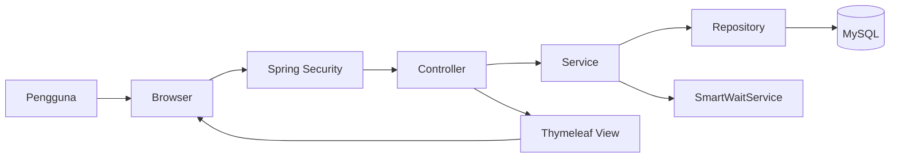

# PRD: QueueCare

## 1. Overview

QueueCare adalah website reservasi dan antrean untuk banyak bisnis jasa (barbershop, salon, servis laptop, klinik kecantikan, dan sejenisnya). Pelanggan bisa mencari bisnis, memilih layanan dan jadwal, lalu mendapat kode reservasi dan nomor antrean. Pemilik bisnis mengelola layanan, jadwal, dan antrean lewat dashboard.

- **Pengguna utama:** Customer (pelanggan), Owner (pemilik bisnis), Administrator (pengelola platform).
- **Masalah yang diselesaikan:** pelanggan tidak tahu kapan gilirannya tiba, dan bisnis belum punya cara rapi untuk mengatur reservasi dan antrean.
- **Fitur unggulan:** SmartWait, yaitu estimasi waktu tunggu yang dihitung dari data antrean, durasi layanan, dan jumlah petugas aktif. SmartWait memakai rumus biasa, bukan AI.
- **Tanda berhasil:** Customer bisa membuat reservasi sampai dapat nomor antrean, Owner bisa memproses antrean dari WAITING sampai COMPLETED, dan Customer bisa melihat estimasi waktu tunggu yang masuk akal di halaman monitoring.

## 2. Requirements

**Yang harus ada**

- R1. Ada tiga role: Administrator, Owner, Customer. Hak akses dicek di backend, bukan hanya disembunyikan di tampilan.
- R2. Pengguna bisa registrasi, login, logout, edit profil, dan ganti password. Email harus unik, password disimpan dalam bentuk hash.
- R3. Customer bisa melihat katalog bisnis tanpa login, mencari berdasarkan nama, dan memfilter berdasarkan kategori. Login wajib hanya saat membuat reservasi.
- R4. Owner bisa mengelola bisnis miliknya sendiri: profil, layanan (harga dan durasi), jadwal operasional, kapasitas, dan jumlah petugas aktif. Owner tidak bisa mengakses bisnis Owner lain.
- R5. Customer bisa membuat reservasi untuk satu bisnis dan satu layanan. Sistem memeriksa jadwal dan kapasitas sebelum menyimpan.
- R6. Reservasi yang berhasil menghasilkan kode reservasi (format `QC-YYYYMMDD-XXXX`) dan satu nomor antrean. Nomor antrean unik per bisnis per tanggal.
- R7. Owner bisa melihat daftar antrean, memanggil pelanggan, dan mengubah status: WAITING → CALLED → IN_SERVICE → COMPLETED. Jalur lain: CANCELLED dan NO_SHOW.
- R8. Customer bisa memantau posisi dan status antrean. Halaman diperbarui berkala (polling atau refresh).
- R9. SmartWait menghitung estimasi waktu tunggu dan menangani kasus petugas aktif = 0.
- R10. Customer bisa melihat riwayat reservasi dan mengajukan pembatalan sebelum antrean masuk tahap pelayanan.
- R11. Owner melihat statistik dan laporan bisnisnya sendiri. Administrator melihat dashboard dan laporan seluruh platform.
- R12. Administrator bisa mengelola akun, kategori bisnis, dan mengaktifkan atau menonaktifkan bisnis. Administrator tidak menangani antrean harian.
- R13. Reservasi dan antrean dibuat dalam satu transaksi database supaya datanya tidak setengah tersimpan.
- R14. Website responsif di desktop, tablet, dan HP, dan bisa dijalankan di komputer lokal.

**Batasan**

- Dikerjakan kelompok 5 orang (Nesya, Revi, Miftah, Khalisa, Rizki), tiap orang memegang satu modul lengkap (frontend dan backend).
- Stack sudah ditentukan: Java Spring Boot, Thymeleaf, Bootstrap 5, MySQL, NetBeans, GitHub.
- Deadline: [isi: tanggal pengumpulan proyek].
- Hosting atau cara demo: [isi: dijalankan lokal saat presentasi atau di-hosting].

**Di luar cakupan (versi pertama)**

- Pembayaran online, WhatsApp/SMS, notifikasi push real-time, integrasi pihak ketiga.
- Rating dan ulasan, membership dan poin, rekomendasi AI.
- Aplikasi mobile native, payroll pegawai, perangkat antrean fisik.
- Pelanggan walk-in tanpa reservasi (lihat Keputusan Terbuka di bawah).

**Keputusan terbuka (kelompok harus memilih sebelum modul terkait dikerjakan)**

| # | Pertanyaan | Usulan awal | Jawaban kelompok |
|---|---|---|---|
| K1 | Reservasi pakai slot waktu atau antrean berjalan? | Pilih satu saja agar sederhana | [isi: slot / antrean berjalan] |
| K2 | Bagaimana kapasitas dan petugas aktif disimpan? | Simpan sebagai angka di data bisnis | [isi: setuju atau pakai tabel terpisah] |
| K3 | Owner daftar sendiri atau dibuatkan Administrator? | Owner daftar, bisnis menunggu verifikasi | [isi: keputusan kelompok] |
| K4 | Perlu dukung walk-in? | Tidak di versi pertama | [isi: ya / tidak] |
| K5 | Kategori disimpan sebagai teks atau tabel `categories`? | Tabel `categories`, karena Admin mengelola kategori (R12) | [isi: keputusan kelompok] |
| K6 | Aturan batas waktu pembatalan | Boleh sebelum status IN_SERVICE | [isi: misal minimal berapa jam sebelum jadwal] |

Catatan revisi (Fase 2): satu Owner boleh mengelola lebih dari satu bisnis (asumsi operasional nomor 3). K3 tetap memakai usulan awal, yaitu Owner mendaftar dan membuat bisnisnya sendiri, lalu bisnis menunggu verifikasi Admin. Owner memilih salah satu bisnis sebagai "bisnis aktif" untuk mengisi layanan, jadwal, dan kapasitas.

## 3. Core Features

Urutan fase mengikuti prioritas di master planning: alur reservasi dan antrean dulu, SmartWait dan laporan setelah datanya benar.

- **Fase 1: Fondasi dan akun (R1, R2, R14).** Project Spring Boot berjalan dan terhubung ke MySQL. Entity dan relasi dasar. Registrasi, login, logout, dan Spring Security dengan pengalihan ke dashboard sesuai role. Layout dasar (navbar, footer, sidebar). Data awal akun Admin, Owner, Customer.
- **Fase 2: Bisnis, layanan, jadwal (R4, R12).** CRUD bisnis, layanan (harga, durasi, aktif/nonaktif), jadwal operasional, dan pengaturan kapasitas serta petugas aktif oleh Owner. Admin mengelola kategori dan status bisnis.
- **Fase 3: Katalog Customer (R3).** Homepage, katalog bisnis dengan pencarian dan filter kategori, halaman detail bisnis (layanan, harga, durasi, jam buka). Hanya bisnis aktif yang tampil.
- **Fase 4: Reservasi dan nomor antrean (R5, R6, R10, R13).** Form reservasi, validasi jadwal dan kapasitas, kode reservasi, pembuatan antrean dalam satu transaksi, halaman sukses, riwayat dan detail reservasi, pembatalan.
- **Fase 5: Operasional antrean dan monitoring (R7, R8).** Dashboard antrean Owner (panggil, mulai layani, selesai, tidak hadir). Validasi alur status. Halaman monitoring Customer dengan refresh berkala.
- **Fase 6: SmartWait (R9).** `SmartWaitService` menghitung estimasi waktu tunggu dan ditampilkan di halaman monitoring dan detail reservasi.
- **Fase 7: Dashboard dan laporan (R11, R12).** Dashboard dan laporan Owner (total reservasi, selesai, batal, layanan terpopuler, filter tanggal). Dashboard dan laporan Admin. Halaman daftar reservasi Admin.
- **Fase 8: Pengujian dan finalisasi (R1, R13, R14).** Uji enam skenario (autentikasi, bisnis, reservasi, antrean, SmartWait, otorisasi), perbaikan bug, cek responsif, akun dan data demo, dokumentasi, SonarQube.

**Rumus SmartWait (pendekatan awal)**

```
Estimasi Waktu Tunggu = (total durasi layanan pelanggan di depan) ÷ (jumlah petugas aktif)
```

Contoh: 4 pelanggan di depan × 15 menit ÷ 2 petugas = 30 menit. Jika petugas aktif = 0, jangan bagi dengan nol. Tampilkan pesan seperti "Estimasi belum tersedia". Pelanggan di depan dihitung dari antrean berstatus WAITING, CALLED, dan IN_SERVICE di bisnis dan tanggal yang sama. Durasi tiap pelanggan diambil dari layanan yang dipilihnya, jadi layanan dengan durasi berbeda tetap terhitung. Status ini perlu dikonfirmasi kelompok: [isi: status mana yang dihitung].

## 4. User Flow

**Fase 1**
1. Pengguna membuka `/login` atau `/register`.
2. Customer mengisi nama, email, password, konfirmasi password, lalu klik daftar.
3. Pengguna login. Sistem mengarahkan Customer ke halaman Customer, Owner ke `/owner`, Admin ke `/admin`.
4. Jika email sudah dipakai atau password salah, tampilkan pesan error yang jelas.
5. Jika Customer membuka `/admin` atau `/owner`, akses ditolak.

**Fase 2**
1. Owner login lalu buka "Business Profile" dan mengisi data bisnis.
2. Owner buka "Services", klik tambah, isi nama, harga, durasi, lalu simpan.
3. Owner buka "Schedules" dan mengatur jam buka, jam tutup, dan hari libur.
4. Owner buka "Capacity" dan mengatur jumlah petugas aktif.
5. Jika harga negatif atau durasi 0, tampilkan pesan validasi.
6. Admin buka "Categories" untuk menambah kategori, dan "Businesses" untuk mengaktifkan atau menonaktifkan bisnis.

**Fase 3**
1. Pengunjung membuka `/` lalu klik "Explore Business".
2. Pengunjung mencari nama atau memilih kategori di `/businesses`.
3. Pengunjung klik satu bisnis dan melihat detail, jam buka, layanan, harga, dan durasi.
4. Jika tidak ada bisnis yang cocok, tampilkan "Bisnis tidak ditemukan".

**Fase 4**
1. Customer klik tombol reservasi pada satu layanan. Jika belum login, diarahkan ke login lalu kembali.
2. Customer memilih tanggal dan waktu, mengisi catatan, lalu klik "Buat Reservasi".
3. Sistem memeriksa jadwal dan kapasitas, lalu menyimpan reservasi dan antrean dalam satu transaksi.
4. Customer melihat halaman sukses berisi kode reservasi dan nomor antrean.
5. Jika waktu di luar jadwal atau kapasitas penuh, reservasi ditolak dengan pesan jelas.
6. Di `/reservations`, Customer melihat riwayat dan bisa membatalkan reservasi yang memenuhi aturan.

**Fase 5**
1. Owner buka "Queue Management" dan melihat daftar antrean hari ini.
2. Owner klik "Panggil", status menjadi CALLED.
3. Owner klik "Mulai", status menjadi IN_SERVICE, lalu "Selesai", status menjadi COMPLETED. Owner juga bisa menandai NO_SHOW.
4. Customer membuka `/queue/{id}` dan melihat nomor, posisi, serta status yang diperbarui berkala.
5. Jika Owner mencoba loncat status (misalnya WAITING langsung COMPLETED), sistem menolak.

**Fase 6**
1. Customer membuka halaman monitoring.
2. Sistem menghitung jumlah pelanggan di depan, durasi layanan, dan petugas aktif.
3. Estimasi waktu tunggu tampil dan dihitung ulang saat status antrean berubah.
4. Jika petugas aktif = 0, tampil pesan "Estimasi belum tersedia" tanpa error.

**Fase 7**
1. Owner buka "Reports", memilih rentang tanggal, lalu melihat total reservasi, selesai, batal, dan layanan terpopuler.
2. Admin buka dashboard dan laporan untuk melihat jumlah pengguna, bisnis, dan reservasi seluruh platform.
3. Jika tidak ada data pada rentang tanggal, tampilkan "Belum ada data".

**Fase 8**
1. Jalankan enam skenario pengujian dan catat hasilnya dengan screenshot.
2. Perbaiki bug, lalu uji ulang alur utama dari reservasi sampai COMPLETED.
3. Siapkan akun demo (Admin, Owner, Customer), data demo, dan hasil SonarQube.

## 5. Architecture



- **Spring Security** memeriksa login dan role sebelum request sampai ke Controller, karena hak akses harus divalidasi di backend (R1).
- **Controller** menerima request dan mengirim data ke halaman Thymeleaf.
- **Service** berisi aturan bisnis: cek jadwal dan kapasitas, buat kode reservasi, buat nomor antrean, validasi alur status (R5, R6, R7). Pembuatan reservasi dan antrean memakai transaksi (R13).
- **SmartWaitService** dibuat terpisah supaya rumus mudah diuji dan diubah (R9).
- **Repository** (Spring Data JPA) mengurus baca dan tulis ke MySQL.
- **Pembaruan antrean** memakai AJAX polling atau refresh berkala, karena lebih sederhana daripada real-time (R8).

## 6. Database Schema

Database: MySQL. Tabel berikut diambil dari master planning. Field bertanda **(usulan)** belum ada di dokumen dan bergantung pada keputusan terbuka K2 dan K5.

**users**

| Field | Tipe | Arti | Fase |
|---|---|---|---|
| id | BIGINT PK | ID pengguna | 1 |
| name | VARCHAR(100) | Nama | 1 |
| email | VARCHAR(150) UNIQUE | Email untuk login | 1 |
| password_hash | VARCHAR(255) | Password yang sudah di-hash | 1 |
| role | VARCHAR(20) | ADMIN, OWNER, CUSTOMER | 1 |
| created_at, updated_at | DATETIME | Waktu dibuat dan diubah | 1 |

**categories (usulan, K5)**

| Field | Tipe | Arti | Fase |
|---|---|---|---|
| id | BIGINT PK | ID kategori | 2 |
| name | VARCHAR(100) UNIQUE | Nama kategori | 2 |

**businesses**

| Field | Tipe | Arti | Fase |
|---|---|---|---|
| id | BIGINT PK | ID bisnis | 2 |
| owner_id | BIGINT FK → users | Pemilik bisnis | 2 |
| name | VARCHAR(150) | Nama bisnis | 2 |
| category | VARCHAR(100) | Kategori (diganti `category_id` bila K5 memilih tabel) | 2 |
| description | TEXT | Deskripsi | 2 |
| address | TEXT | Alamat | 2 |
| phone | VARCHAR(20) | Nomor telepon | 2 |
| status | VARCHAR(20) | Status bisnis (aktif, nonaktif, menunggu verifikasi bila K3) | 2 |
| active_staff_count | INT | Jumlah petugas aktif **(usulan, K2)** | 2 |
| max_capacity | INT | Batas kapasitas pelayanan **(usulan, K1 dan K2)** | 2 |
| created_at, updated_at | DATETIME | Waktu dibuat dan diubah | 2 |

**services**

| Field | Tipe | Arti | Fase |
|---|---|---|---|
| id | BIGINT PK | ID layanan | 2 |
| business_id | BIGINT FK → businesses | Bisnis pemilik | 2 |
| name | VARCHAR(150) | Nama layanan | 2 |
| description | TEXT | Deskripsi | 2 |
| price | DECIMAL(10,2) | Harga, tidak boleh negatif | 2 |
| estimated_duration_minutes | INT | Durasi, harus lebih dari 0 | 2 |
| is_active | BOOLEAN | Bisa dipilih atau tidak | 2 |
| created_at, updated_at | DATETIME | Waktu dibuat dan diubah | 2 |

**business_schedules**

| Field | Tipe | Arti | Fase |
|---|---|---|---|
| id | BIGINT PK | ID jadwal | 2 |
| business_id | BIGINT FK → businesses | Bisnis | 2 |
| day_of_week | VARCHAR(15) | Hari operasional | 2 |
| open_time, close_time | TIME | Jam buka dan tutup | 2 |
| is_closed | BOOLEAN | Libur atau tidak | 2 |

**reservations**

| Field | Tipe | Arti | Fase |
|---|---|---|---|
| id | BIGINT PK | ID reservasi | 4 |
| customer_id | BIGINT FK → users | Pelanggan | 4 |
| business_id | BIGINT FK → businesses | Bisnis | 4 |
| service_id | BIGINT FK → services | Layanan | 4 |
| reservation_code | VARCHAR(30) UNIQUE | Contoh `QC-20261110-0001` | 4 |
| reservation_date | DATE | Tanggal | 4 |
| reservation_time | TIME | Waktu | 4 |
| status | VARCHAR(20) | PENDING, CONFIRMED, CANCELLED, COMPLETED | 4 |
| notes | TEXT | Catatan pelanggan | 4 |
| created_at, updated_at | DATETIME | Waktu dibuat dan diubah | 4 |

**queues**

| Field | Tipe | Arti | Fase |
|---|---|---|---|
| id | BIGINT PK | ID antrean | 4 |
| reservation_id | BIGINT FK UNIQUE → reservations | Satu reservasi, paling banyak satu antrean | 4 |
| queue_number | INT | Nomor, unik per bisnis per tanggal | 4 |
| queue_date | DATE | Tanggal antrean | 4 |
| status | VARCHAR(20) | WAITING, CALLED, IN_SERVICE, COMPLETED, CANCELLED, NO_SHOW | 4 |
| called_at | DATETIME | Waktu dipanggil | 5 |
| started_at | DATETIME | Waktu mulai dilayani | 5 |
| completed_at | DATETIME | Waktu selesai | 5 |
| created_at | DATETIME | Waktu dibuat | 4 |

Catatan: karena `queues` tidak punya `business_id`, keunikan nomor antrean per bisnis harus lewat `reservation_id` ke `reservations.business_id`. Kelompok bisa memilih menambah `business_id` ke `queues` agar pengecekan lebih mudah: [isi: keputusan kelompok].

**Tabel opsional:** `reservation_status_histories` dan `queue_status_histories` untuk riwayat perubahan status (dipakai bila Khalisa dan Miftah memutuskan perlu).

**Relasi:** users 1:M businesses, businesses 1:M services, businesses 1:M business_schedules, users 1:M reservations, businesses 1:M reservations, services 1:M reservations, reservations 1:0..1 queues.

**Contoh data:**

```
reservations: { id: 1, customer_id: 7, business_id: 2, service_id: 5,
  reservation_code: "QC-20261110-0001", reservation_date: "2026-11-10",
  reservation_time: "10:00", status: "CONFIRMED" }
queues: { id: 1, reservation_id: 1, queue_number: 1,
  queue_date: "2026-11-10", status: "WAITING" }
```

## 7. Tech Stack

| Bagian | Pilihan | Alasan |
|---|---|---|
| Tampilan | HTML5, CSS3, Bootstrap 5 | Grid dan komponen siap pakai, cocok untuk tampilan responsif di semua perangkat (R14). |
| Interaksi | JavaScript (AJAX) | Memperbarui antrean dan estimasi tanpa muat ulang halaman (R8). |
| Template | Thymeleaf | Menampilkan data dari backend langsung ke HTML dan terintegrasi dengan Spring (R3, R5). |
| Backend | Java + Spring Boot + Spring MVC | Sudah ditetapkan kelompok, dan memisahkan Controller, Service, Repository (R5, R7). |
| Keamanan | Spring Security | Login, hash password, dan pembatasan akses per role (R1, R2). |
| Akses data | Spring Data JPA + Hibernate | Menghubungkan entity Java dengan tabel MySQL tanpa banyak SQL manual (R13). |
| Database | MySQL (phpMyAdmin) | Data relasional dengan relasi dan aturan unik yang jelas (R6). |
| Build | Maven | Mengatur dependency dan build project. |
| IDE | NetBeans | Ditetapkan kelompok untuk pengembangan. |
| Kolaborasi | Git dan GitHub | Lima anggota bekerja paralel dan commit berkala. |
| Pengujian | Postman, Chrome DevTools, SonarQube | Uji endpoint, debug tampilan, dan analisis kualitas kode (Fase 8). |
| Hosting | [isi: lokal atau layanan hosting] | Dokumen hanya mewajibkan bisa jalan di lingkungan lokal (R14). |

**Pembagian modul (dari master planning)**

| Anggota | Modul | Fase utama |
|---|---|---|
| Nesya | Authentication & User Role, fondasi project | 1 |
| Revi | Business & Service Management, proposal | 2, 3 |
| Miftah | Reservation Management | 4 |
| Khalisa | Queue Operation & Monitoring | 5 |
| Rizki | SmartWait & statistik monitoring | 6, 7 |