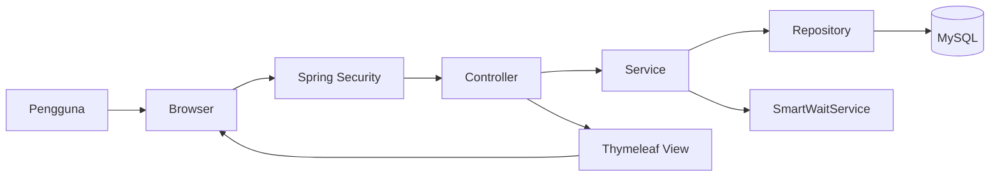

# PRD: QueueCare

## 1. Overview

QueueCare adalah website reservasi dan antrean untuk banyak bisnis jasa (barbershop, salon, servis laptop, klinik kecantikan, dan sejenisnya). Pelanggan bisa mencari bisnis, memilih layanan dan jadwal, lalu mendapat kode reservasi dan nomor antrean. Pemilik bisnis mengelola layanan, jadwal, dan antrean lewat dashboard.

- **Pengguna utama:** Customer (pelanggan), Owner (pemilik bisnis), Administrator (pengelola platform).
- **Masalah yang diselesaikan:** pelanggan tidak tahu kapan gilirannya tiba, dan bisnis belum punya cara rapi untuk mengatur reservasi dan antrean.
- **Fitur unggulan:** SmartWait, yaitu estimasi waktu tunggu yang dihitung dari data antrean, durasi layanan, dan jumlah petugas aktif. SmartWait memakai rumus biasa, bukan AI.
- **Tanda berhasil:** Customer bisa membuat reservasi sampai dapat nomor antrean, Owner bisa memproses antrean dari WAITING sampai COMPLETED, dan Customer bisa melihat estimasi waktu tunggu yang masuk akal di halaman monitoring.

## 2. Requirements

**Yang harus ada**

- R1. Ada tiga role: Administrator, Owner, Customer. Hak akses dicek di backend, bukan hanya disembunyikan di tampilan.
- R2. Pengguna bisa registrasi, login, logout, edit profil, dan ganti password. Email harus unik, password disimpan dalam bentuk hash.
- R3. Customer bisa melihat katalog bisnis tanpa login, mencari berdasarkan nama, dan memfilter berdasarkan kategori. Login wajib hanya saat membuat reservasi.
- R4. Owner bisa mengelola bisnis miliknya sendiri: profil, layanan (harga dan durasi), jadwal operasional, kapasitas, dan jumlah petugas aktif. Owner tidak bisa mengakses bisnis Owner lain.
- R5. Customer bisa membuat reservasi untuk satu bisnis dan satu layanan. Sistem memeriksa jadwal dan kapasitas sebelum menyimpan.
- R6. Reservasi yang berhasil menghasilkan kode reservasi (format `QC-YYYYMMDD-XXXX`) dan satu nomor antrean. Nomor antrean unik per bisnis per tanggal.
- R7. Owner bisa melihat daftar antrean, memanggil pelanggan, dan mengubah status: WAITING → CALLED → IN_SERVICE → COMPLETED. Jalur lain: CANCELLED dan NO_SHOW.
- R8. Customer bisa memantau posisi dan status antrean. Halaman diperbarui berkala (polling atau refresh).
- R9. SmartWait menghitung estimasi waktu tunggu dan menangani kasus petugas aktif = 0.
- R10. Customer bisa melihat riwayat reservasi dan mengajukan pembatalan sebelum antrean masuk tahap pelayanan.
- R11. Owner melihat statistik dan laporan bisnisnya sendiri. Administrator melihat dashboard dan laporan seluruh platform.
- R12. Administrator bisa mengelola akun, kategori bisnis, dan mengaktifkan atau menonaktifkan bisnis. Administrator tidak menangani antrean harian.
- R13. Reservasi dan antrean dibuat dalam satu transaksi database supaya datanya tidak setengah tersimpan.
- R14. Website responsif di desktop, tablet, dan HP, dan bisa dijalankan di komputer lokal.

**Batasan**

- Dikerjakan kelompok 5 orang (Nesya, Revi, Miftah, Khalisa, Rizki), tiap orang memegang satu modul lengkap (frontend dan backend).
- Stack sudah ditentukan: Java Spring Boot, Thymeleaf, Bootstrap 5, MySQL, NetBeans, GitHub.
- Deadline: [isi: tanggal pengumpulan proyek].
- Hosting atau cara demo: [isi: dijalankan lokal saat presentasi atau di-hosting].

**Di luar cakupan (versi pertama)**

- Pembayaran online, WhatsApp/SMS, notifikasi push real-time, integrasi pihak ketiga.
- Rating dan ulasan, membership dan poin, rekomendasi AI.
- Aplikasi mobile native, payroll pegawai, perangkat antrean fisik.
- Pelanggan walk-in tanpa reservasi (lihat Keputusan Terbuka di bawah).

**Keputusan terbuka (kelompok harus memilih sebelum modul terkait dikerjakan)**

Diperbarui 22 Nov 2026: semua pertanyaan K1–K6 sudah diputuskan pemilik proyek; jawaban ada di kolom "Jawaban kelompok" dan dirangkum di bagian 8.1.

| # | Pertanyaan | Usulan awal | Jawaban kelompok |
|---|---|---|---|
| K1 | Reservasi pakai slot waktu atau antrean berjalan? | Pilih satu saja agar sederhana | Antrean berjalan + grid slot 30 menit. Reservasi memesan slot, sistem memberi nomor antrean; SmartWait memakai nomor antrean. Tidak ada opsi walk-in (lihat K4). |
| K2 | Bagaimana kapasitas dan petugas aktif disimpan? | Simpan sebagai angka di data bisnis | Setuju — dua angka (active_staff_count, max_capacity) disimpan di tabel businesses, diatur Owner di halaman Kapasitas. |
| K3 | Owner daftar sendiri atau dibuatkan Administrator? | Owner daftar, bisnis menunggu verifikasi | Owner dibuat oleh Administrator (Fase 7b). Registrasi publik hanya membuat Customer. Bisnis baru menunggu verifikasi Admin. Catatan Fase 2 di baris 56 sudah tidak berlaku. |
| K4 | Perlu dukung walk-in? | Tidak di versi pertama | Tidak. Walk-in sengaja di luar cakupan versi pertama (lihat bagian Di luar cakupan). |
| K5 | Kategori disimpan sebagai teks atau tabel `categories`? | Tabel categories, karena Admin mengelola kategori (R12) | Tabel categories. businesses.category_id adalah FK NOT NULL; Admin mengelola kategori lewat R12. |
| K6 | Aturan batas waktu pembatalan | Boleh sebelum status IN_SERVICE | Customer hanya dapat membatalkan saat antrean WAITING; Owner dapat membatalkan sampai CALLED. Tidak ada batas minimal jam (versi pertama). |

Catatan revisi (Fase 2): satu Owner boleh mengelola lebih dari satu bisnis (asumsi operasional nomor 3). K3 tetap memakai usulan awal, yaitu Owner mendaftar dan membuat bisnisnya sendiri, lalu bisnis menunggu verifikasi Admin. Owner memilih salah satu bisnis sebagai "bisnis aktif" untuk mengisi layanan, jadwal, dan kapasitas.

Diperbarui 22 Nov 2026 (K3): kalimat "K3 tetap memakai usulan awal, yaitu Owner mendaftar dan membuat bisnisnya sendiri" sudah tidak berlaku. Fase 7b memutuskan akun Owner dibuat oleh Administrator (`AuthService.register()` selalu membuat role CUSTOMER), dan bisnis baru menunggu verifikasi Admin. Lihat jawaban K3 di atas dan `PRD.md` catatan Fase 7b. Kalimat asli di atas sengaja tidak dihapus.

## 3. Core Features

Urutan fase mengikuti prioritas di master planning: alur reservasi dan antrean dulu, SmartWait dan laporan setelah datanya benar.

- **Fase 1: Fondasi dan akun (R1, R2, R14).** Project Spring Boot berjalan dan terhubung ke MySQL. Entity dan relasi dasar. Registrasi, login, logout, dan Spring Security dengan pengalihan ke dashboard sesuai role. Layout dasar (navbar, footer, sidebar). Data awal akun Admin, Owner, Customer.
- **Fase 2: Bisnis, layanan, jadwal (R4, R12).** CRUD bisnis, layanan (harga, durasi, aktif/nonaktif), jadwal operasional, dan pengaturan kapasitas serta petugas aktif oleh Owner. Admin mengelola kategori dan status bisnis.
- **Fase 3: Katalog Customer (R3).** Homepage, katalog bisnis dengan pencarian dan filter kategori, halaman detail bisnis (layanan, harga, durasi, jam buka). Hanya bisnis aktif yang tampil.
- **Fase 4: Reservasi dan nomor antrean (R5, R6, R10, R13).** Form reservasi, validasi jadwal dan kapasitas, kode reservasi, pembuatan antrean dalam satu transaksi, halaman sukses, riwayat dan detail reservasi, pembatalan.
- **Fase 5: Operasional antrean dan monitoring (R7, R8).** Dashboard antrean Owner (panggil, mulai layani, selesai, tidak hadir). Validasi alur status. Halaman monitoring Customer dengan refresh berkala.
- **Fase 6: SmartWait (R9).** `SmartWaitService` menghitung estimasi waktu tunggu dan ditampilkan di halaman monitoring dan detail reservasi.
- **Fase 7: Dashboard dan laporan (R11, R12).** Dashboard dan laporan Owner (total reservasi, selesai, batal, layanan terpopuler, filter tanggal). Dashboard dan laporan Admin. Halaman daftar reservasi Admin.
- **Fase 8: Pengujian dan finalisasi (R1, R13, R14).** Uji enam skenario (autentikasi, bisnis, reservasi, antrean, SmartWait, otorisasi), perbaikan bug, cek responsif, akun dan data demo, dokumentasi, SonarQube.

**Rumus SmartWait (pendekatan awal)**

```
Estimasi Waktu Tunggu = (total durasi layanan pelanggan di depan) ÷ (jumlah petugas aktif)
```

Contoh: 4 pelanggan di depan × 15 menit ÷ 2 petugas = 30 menit. Jika petugas aktif = 0, jangan bagi dengan nol. Tampilkan pesan seperti "Estimasi belum tersedia". Pelanggan di depan dihitung dari antrean berstatus WAITING, CALLED, dan IN_SERVICE di bisnis dan tanggal yang sama. Durasi tiap pelanggan diambil dari layanan yang dipilihnya, jadi layanan dengan durasi berbeda tetap terhitung. Status ini perlu dikonfirmasi kelompok: [isi: status mana yang dihitung].

Diperbarui 22 Nov 2026 (K1, M7): pertanyaan "status mana yang dihitung" sudah dijawab Keputusan Fase 6 (2026-11-15): pelanggan di depan adalah antrean sebisnis/se-tanggal dengan nomor lebih kecil dan status WAITING, CALLED, atau IN_SERVICE. Lihat catatan Fase 6 di bawah. Teks asli di atas sengaja tidak dihapus.

## 4. User Flow

**Fase 1**
1. Pengguna membuka `/login` atau `/register`.
2. Customer mengisi nama, email, password, konfirmasi password, lalu klik daftar.
3. Pengguna login. Sistem mengarahkan Customer ke halaman Customer, Owner ke `/owner`, Admin ke `/admin`.
4. Jika email sudah dipakai atau password salah, tampilkan pesan error yang jelas.
5. Jika Customer membuka `/admin` atau `/owner`, akses ditolak.

**Fase 2**
1. Owner login lalu buka "Business Profile" dan mengisi data bisnis.
2. Owner buka "Services", klik tambah, isi nama, harga, durasi, lalu simpan.
3. Owner buka "Schedules" dan mengatur jam buka, jam tutup, dan hari libur.
4. Owner buka "Capacity" dan mengatur jumlah petugas aktif.
5. Jika harga negatif atau durasi 0, tampilkan pesan validasi.
6. Admin buka "Categories" untuk menambah kategori, dan "Businesses" untuk mengaktifkan atau menonaktifkan bisnis.

**Fase 3**
1. Pengunjung membuka `/` lalu klik "Explore Business".
2. Pengunjung mencari nama atau memilih kategori di `/businesses`.
3. Pengunjung klik satu bisnis dan melihat detail, jam buka, layanan, harga, dan durasi.
4. Jika tidak ada bisnis yang cocok, tampilkan "Bisnis tidak ditemukan".

**Fase 4**
1. Customer klik tombol reservasi pada satu layanan. Jika belum login, diarahkan ke login lalu kembali.

Diperbarui 22 Nov 2026 (SavedRequest): "kembali" di atas kini benar-benar terjadi. Sebelum login, Spring Security menyimpan request tujuan (RequestCache). Setelah login, Customer diarahkan ke halaman yang tadi dituju (misalnya form reservasi), bukan ke dashboard. Owner dan Admin selalu ke dashboard perannya. Kunjungan langsung ke `/login` tanpa tujuan tersimpan juga ke dashboard perannya. Tujuan tersimpan yang menunjuk ke domain luar tidak diikuti (anti open redirect). Lihat catatan SavedRequest di akhir dokumen ini.

2. Customer memilih tanggal dan waktu, mengisi catatan, lalu klik "Buat Reservasi".
3. Sistem memeriksa jadwal dan kapasitas, lalu menyimpan reservasi dan antrean dalam satu transaksi.
4. Customer melihat halaman sukses berisi kode reservasi dan nomor antrean.
5. Jika waktu di luar jadwal atau kapasitas penuh, reservasi ditolak dengan pesan jelas.
6. Di `/reservations`, Customer melihat riwayat dan bisa membatalkan reservasi yang memenuhi aturan.

**Fase 5**
1. Owner buka "Queue Management" dan melihat daftar antrean hari ini.
2. Owner klik "Panggil", status menjadi CALLED.
3. Owner klik "Mulai", status menjadi IN_SERVICE, lalu "Selesai", status menjadi COMPLETED. Owner juga bisa menandai NO_SHOW.
4. Customer membuka `/queue/{id}` dan melihat nomor, posisi, serta status yang diperbarui berkala.
5. Jika Owner mencoba loncat status (misalnya WAITING langsung COMPLETED), sistem menolak.

**Fase 6**
1. Customer membuka halaman monitoring.
2. Sistem menghitung jumlah pelanggan di depan, durasi layanan, dan petugas aktif.
3. Estimasi waktu tunggu tampil dan dihitung ulang saat status antrean berubah.
4. Jika petugas aktif = 0, tampil pesan "Estimasi belum tersedia" tanpa error.

**Fase 7**
1. Owner buka "Reports", memilih rentang tanggal, lalu melihat total reservasi, selesai, batal, dan layanan terpopuler.
2. Admin buka dashboard dan laporan untuk melihat jumlah pengguna, bisnis, dan reservasi seluruh platform.
3. Jika tidak ada data pada rentang tanggal, tampilkan "Belum ada data".

**Fase 8**
1. Jalankan enam skenario pengujian dan catat hasilnya dengan screenshot.
2. Perbaiki bug, lalu uji ulang alur utama dari reservasi sampai COMPLETED.
3. Siapkan akun demo (Admin, Owner, Customer), data demo, dan hasil SonarQube.

## 5. Architecture



- **Spring Security** memeriksa login dan role sebelum request sampai ke Controller, karena hak akses harus divalidasi di backend (R1).
- **Controller** menerima request dan mengirim data ke halaman Thymeleaf.
- **Service** berisi aturan bisnis: cek jadwal dan kapasitas, buat kode reservasi, buat nomor antrean, validasi alur status (R5, R6, R7). Pembuatan reservasi dan antrean memakai transaksi (R13).
- **SmartWaitService** dibuat terpisah supaya rumus mudah diuji dan diubah (R9).
- **Repository** (Spring Data JPA) mengurus baca dan tulis ke MySQL.
- **Pembaruan antrean** memakai AJAX polling atau refresh berkala, karena lebih sederhana daripada real-time (R8).

## 6. Database Schema

Database: MySQL. Tabel berikut diambil dari master planning. Field bertanda **(usulan)** belum ada di dokumen dan bergantung pada keputusan terbuka K2 dan K5.

Diperbarui 22 Nov 2026 (K2, K5): penanda **(usulan)** dan "bergantung pada keputusan terbuka K2 dan K5" sudah tidak berlaku — K2 dan K5 sudah diputuskan (lihat bagian 8.1). Label usulan pada baris tabel di bawah sengaja dibiarkan dan dicatat di 8.2 (M3).

**users**

| Field | Tipe | Arti | Fase |
|---|---|---|---|
| id | BIGINT PK | ID pengguna | 1 |
| name | VARCHAR(100) | Nama | 1 |
| email | VARCHAR(150) UNIQUE | Email untuk login | 1 |
| password_hash | VARCHAR(255) | Password yang sudah di-hash | 1 |
| role | VARCHAR(20) | ADMIN, OWNER, CUSTOMER | 1 |
| active | BOOLEAN default TRUE | Akun nonaktif tidak bisa login (ditambah Fase 7b, R1) | 7b |
| created_at, updated_at | DATETIME | Waktu dibuat dan diubah | 1 |

**categories (usulan, K5)**

| Field | Tipe | Arti | Fase |
|---|---|---|---|
| id | BIGINT PK | ID kategori | 2 |
| name | VARCHAR(100) UNIQUE | Nama kategori | 2 |

Diperbarui 22 Nov 2026 (K5): label "usulan" sudah tidak berlaku. Tabel `categories` dan kolom `businesses.category_id` FK NOT NULL sudah ada di kode (`Business.java:36-38`) dan skema (`database/queuecare.sql`), dan Admin mengelola kategori lewat R12. Judul asli di atas sengaja tidak dihapus.

**businesses**

| Field | Tipe | Arti | Fase |
|---|---|---|---|
| id | BIGINT PK | ID bisnis | 2 |
| owner_id | BIGINT FK → users | Pemilik bisnis | 2 |
| name | VARCHAR(150) | Nama bisnis | 2 |
| category | VARCHAR(100) | Kategori (diganti `category_id` bila K5 memilih tabel) | 2 |
| description | TEXT | Deskripsi | 2 |
| address | TEXT | Alamat | 2 |
| phone | VARCHAR(20) | Nomor telepon | 2 |
| status | VARCHAR(20) | Status bisnis (aktif, nonaktif, menunggu verifikasi bila K3) | 2 |
| active_staff_count | INT | Jumlah petugas aktif **(usulan, K2)** | 2 |
| max_capacity | INT | Batas kapasitas pelayanan **(usulan, K1 dan K2)** | 2 |
| created_at, updated_at | DATETIME | Waktu dibuat dan diubah | 2 |

Diperbarui 22 Nov 2026 (K2, K5, M3): kolom `category` VARCHAR(100) sudah diganti di kode dan skema menjadi kolom `category_id` FK NOT NULL ke tabel `categories` (`Business.java`, `database/queuecare.sql`). Label **(usulan, K2)** dan **(usulan, K1 dan K2)** sudah tidak berlaku: kapasitas (`max_capacity`) dan petugas aktif (`active_staff_count`) memang disimpan sebagai dua angka di tabel `businesses`. Teks berlabel di atas sengaja tidak dihapus.

**services**

| Field | Tipe | Arti | Fase |
|---|---|---|---|
| id | BIGINT PK | ID layanan | 2 |
| business_id | BIGINT FK → businesses | Bisnis pemilik | 2 |
| name | VARCHAR(150) | Nama layanan | 2 |
| description | TEXT | Deskripsi | 2 |
| price | DECIMAL(10,2) | Harga, tidak boleh negatif | 2 |
| estimated_duration_minutes | INT | Durasi, harus lebih dari 0 | 2 |
| is_active | BOOLEAN | Bisa dipilih atau tidak | 2 |
| created_at, updated_at | DATETIME | Waktu dibuat dan diubah | 2 |

**business_schedules**

| Field | Tipe | Arti | Fase |
|---|---|---|---|
| id | BIGINT PK | ID jadwal | 2 |
| business_id | BIGINT FK → businesses | Bisnis | 2 |
| day_of_week | VARCHAR(15) | Hari operasional | 2 |
| open_time, close_time | TIME | Jam buka dan tutup | 2 |
| is_closed | BOOLEAN | Libur atau tidak | 2 |

**reservations**

| Field | Tipe | Arti | Fase |
|---|---|---|---|
| id | BIGINT PK | ID reservasi | 4 |
| customer_id | BIGINT FK → users | Pelanggan | 4 |
| business_id | BIGINT FK → businesses | Bisnis | 4 |
| service_id | BIGINT FK → services | Layanan | 4 |
| reservation_code | VARCHAR(30) UNIQUE | Contoh `QC-20261110-0001` | 4 |
| reservation_date | DATE | Tanggal | 4 |
| reservation_time | TIME | Waktu | 4 |
| status | VARCHAR(20) | PENDING, CONFIRMED, CANCELLED, COMPLETED | 4 |
| notes | TEXT | Catatan pelanggan | 4 |
| created_at, updated_at | DATETIME | Waktu dibuat dan diubah | 4 |

**queues**

| Field | Tipe | Arti | Fase |
|---|---|---|---|
| id | BIGINT PK | ID antrean | 4 |
| reservation_id | BIGINT FK UNIQUE → reservations | Satu reservasi, paling banyak satu antrean | 4 |
| business_id | BIGINT FK → businesses | Bisnis tempat antrean, dipakai untuk keunikan nomor per bisnis per tanggal | 4 |
| queue_number | INT | Nomor, unik per bisnis per tanggal | 4 |
| queue_date | DATE | Tanggal antrean | 4 |
| status | VARCHAR(20) | WAITING, CALLED, IN_SERVICE, COMPLETED, CANCELLED, NO_SHOW | 4 |
| called_at | DATETIME | Waktu dipanggil | 5 |
| started_at | DATETIME | Waktu mulai dilayani | 5 |
| completed_at | DATETIME | Waktu selesai | 5 |
| created_at | DATETIME | Waktu dibuat | 4 |

Catatan: karena `queues` tidak punya `business_id`, keunikan nomor antrean per bisnis harus lewat `reservation_id` ke `reservations.business_id`. Kelompok bisa memilih menambah `business_id` ke `queues` agar pengecekan lebih mudah: [isi: keputusan kelompok].

Diperbarui 22 Nov 2026 (M4): catatan di atas sudah kedaluwarsa. `queues` sekarang punya `business_id`, dan Keputusan Fase 4 (2026-11-15) menambahkan constraint unik `(business_id, queue_date, queue_number)` bernama `uk_queues_nomor`. Lihat Keputusan Fase 4 di bawah. Teks asli sengaja tidak dihapus.

Keputusan Fase 4 (2026-11-15): `business_id` ditambahkan ke `queues`, dan dibuat constraint unik `(business_id, queue_date, queue_number)` bernama `uk_queues_nomor` supaya aturan nomor berurutan per bisnis per tanggal dijaga database, bukan hanya aplikasi. Isi lama di atas sengaja tidak dihapus.

Keputusan Fase 5 (2026-11-15): transisi antrean yang diizinkan hanya WAITING → CALLED, WAITING → CANCELLED, CALLED → IN_SERVICE, CALLED → NO_SHOW, CALLED → CANCELLED, dan IN_SERVICE → COMPLETED. Status COMPLETED, CANCELLED, dan NO_SHOW tidak bisa diubah lagi. Setiap perubahan antrean menyelaraskan status reservasi dalam transaksi yang sama: antrean COMPLETED membuat reservasi COMPLETED, antrean CANCELLED membuat reservasi CANCELLED, dan antrean NO_SHOW membuat reservasi CANCELLED (jalur NO_SHOW ini usulan, perlu persetujuan kelompok). `called_at`, `started_at`, dan `completed_at` diisi saat status yang bersangkutan ditetapkan. Isi lama di atas sengaja tidak dihapus.

Diperbarui 22 Nov 2026 (M8): jalur NO_SHOW → CANCELLED sudah disetujui pemilik proyek dan diimplementasikan (`QueueService.java`, diuji di `docs/pengujian.md`). Label "usulan, perlu persetujuan kelompok" di atas sudah tidak berlaku. Teks asli sengaja tidak dihapus.

Keputusan Fase 6 (2026-11-15): SmartWait bukan AI, melainkan rumus aturan. Estimasi menit = pembulatan ke atas dari total `estimated_duration_minutes` layanan semua pelanggan di depan dibagi `active_staff_count` bisnis. Pelanggan di depan adalah antrean sebisnis/se-tanggal dengan nomor lebih kecil dan status WAITING, CALLED, atau IN_SERVICE (sama dengan aturan posisi antrean), dan durasi tiap pelanggan diambil dari layanan yang dipilihnya. Kondisi khusus: petugas 0 menampilkan "Estimasi belum tersedia" (tidak ada pembagian nol); tidak ada pelanggan di depan dan antrean sendiri WAITING menampilkan "Kamu berikutnya"; antrean sendiri CALLED menampilkan "Kamu sudah dipanggil, silakan menuju lokasi"; antrean IN_SERVICE atau final tidak menampilkan estimasi. Perhitungan ada di `SmartWaitService.hitungMenit` sebagai fungsi murni supaya mudah diuji tanpa database. Isi lama di atas sengaja tidak dihapus.

Keputusan Fase 7 (2026-11-15): Definisi angka: dashboard Owner "reservasi hari ini" = `reservations` bisnis aktif dengan `reservation_date = hari ini`; "antrean menunggu" = seluruh antrean bisnis berstatus WAITING; "sedang dilayani" = CALLED + IN_SERVICE; "selesai hari ini" = antrean COMPLETED dengan `reservation_date = hari ini`. Laporan Owner memakai rentang `reservation_date` (bawaan 30 hari terakhir) untuk total reservasi, reservasi hari ini, antrean COMPLETED/CANCELLED/NO_SHOW, dan pelanggan unik; layanan terpopuler `GROUP BY services.name` lima teratas. Laporan Admin memakai rentang yang sama (tanggal kosong berarti tanpa batas) untuk total reservasi dan tabel per hari, sementara total bisnis, pengguna, dan ringkasan status antrean dihitung seluruh platform. Daftar `/admin/reservations` difilter dengan `reservation_date`, `business_id`, dan `status`, dua puluh baris per halaman. Isi lama di atas sengaja tidak dihapus.

Keputusan Fase 7b (2026-11-15): tabel `users` ditambah kolom `active` (BOOLEAN, bawaan TRUE). Akun nonaktif ditolak dua kali: saat login (`UserDetails.disabled`) dan pada request berikutnya lewat `AkunNonaktifFilter`, yang mengosongkan konteks keamanan, membuang sesi, dan mengarahkan ke `/login?disabled`. Pesan login tetap generik ("Email atau password salah.") dan hanya akun nonaktif yang mendapat pesan khusus, supaya tidak membocorkan apakah email terdaftar (KNF-03). Aturan keselamatan di `AdminUserService`: Admin tidak boleh menonaktifkan atau mengubah role akunnya sendiri; Admin aktif terakhir tidak boleh dinonaktifkan atau diturunkan; Owner yang masih memegang bisnis tidak boleh diubah jadi role lain. Menonaktifkan Owner tidak menghapus maupun menyembatkan bisnisnya: bisnis tetap ada dan tetap terlihat di katalog dan laporan, hanya pemiliknya tidak bisa masuk. Pendaftaran Owner mandiri tidak dibuat, akun Owner dibuat Admin. Setelah email profil diubah, pengguna diminta masuk ulang karena email dipakai sebagai nama login; ini pilihan paling sederhana, sesi lama tidak lagi cocok dengan baris `users`.

**Tabel opsional:** `reservation_status_histories` dan `queue_status_histories` untuk riwayat perubahan status (dipakai bila Khalisa dan Miftah memutuskan perlu).

**Relasi:** users 1:M businesses, businesses 1:M services, businesses 1:M business_schedules, users 1:M reservations, businesses 1:M reservations, services 1:M reservations, reservations 1:0..1 queues.

**Contoh data:**

```
reservations: { id: 1, customer_id: 7, business_id: 2, service_id: 5,
  reservation_code: "QC-20261110-0001", reservation_date: "2026-11-10",
  reservation_time: "10:00", status: "CONFIRMED" }
queues: { id: 1, reservation_id: 1, queue_number: 1,
  queue_date: "2026-11-10", status: "WAITING" }
```

## 7. Tech Stack

| Bagian | Pilihan | Alasan |
|---|---|---|
| Tampilan | HTML5, CSS3, Bootstrap 5 | Grid dan komponen siap pakai, cocok untuk tampilan responsif di semua perangkat (R14). |
| Interaksi | JavaScript (AJAX) | Memperbarui antrean dan estimasi tanpa muat ulang halaman (R8). |
| Template | Thymeleaf | Menampilkan data dari backend langsung ke HTML dan terintegrasi dengan Spring (R3, R5). |
| Backend | Java + Spring Boot + Spring MVC | Sudah ditetapkan kelompok, dan memisahkan Controller, Service, Repository (R5, R7). |
| Keamanan | Spring Security | Login, hash password, dan pembatasan akses per role (R1, R2). |
| Akses data | Spring Data JPA + Hibernate | Menghubungkan entity Java dengan tabel MySQL tanpa banyak SQL manual (R13). |
| Database | MySQL (phpMyAdmin) | Data relasional dengan relasi dan aturan unik yang jelas (R6). |
| Build | Maven | Mengatur dependency dan build project. |
| IDE | NetBeans | Ditetapkan kelompok untuk pengembangan. |
| Kolaborasi | Git dan GitHub | Lima anggota bekerja paralel dan commit berkala. |
| Pengujian | Postman, Chrome DevTools, SonarQube | Uji endpoint, debug tampilan, dan analisis kualitas kode (Fase 8). |
| Hosting | [isi: lokal atau layanan hosting] | Dokumen hanya mewajibkan bisa jalan di lingkungan lokal (R14). |

**Pembagian modul (dari master planning)**

| Anggota | Modul | Fase utama |
|---|---|---|
| Nesya | Authentication & User Role, fondasi project | 1 |
| Revi | Business & Service Management, proposal | 2, 3 |
| Miftah | Reservation Management | 4 |
| Khalisa | Queue Operation & Monitoring | 5 |
| Rizki | SmartWait & statistik monitoring | 6, 7 |

---

## 8. Keputusan implementasi 22 Nov 2026

Bagian ini ditambahkan setelah keputusan K1–K6, D1–D3, jalur NO_SHOW→CANCELLED, dan SavedRequest disetujui pemilik proyek. Isi teks lama di atas tidak dihapus; yang berubah hanya diberi catatan "Diperbarui 22 Nov 2026" tepat setelahnya.

### 8.1 Ringkasan keputusan

- **K1** — Tetap keduanya: antrean berjalan + grid slot 30 menit.
- **K2** — Setuju: kapasitas dan petugas aktif berupa angka di tabel `businesses`.
- **K3** — Owner dibuat oleh Administrator; catatan Fase 2 di baris 56 sudah tidak berlaku.
- **K4** — Walk-in tetap di luar cakupan versi pertama.
- **K5** — Tabel `categories` + `businesses.category_id` FK NOT NULL.
- **K6** — Status quo: Customer hanya saat antrean WAITING, Owner sampai CALLED, tanpa batas jam. Batas jam dicatat sebagai pengembangan lanjutan (lihat 8.5).
- **D1** — Diterima dan didokumentasikan, aturan tidak diubah.
- **D2** — Diterima, ditambah teks bantuan di `templates/profile.html`.
- **D3** — Reset password oleh Admin wajib berbeda dari password lama (samakan dengan aturan ganti password sendiri).
- **Jalur NO_SHOW→CANCELLED** — Disetujui.
- **SavedRequest** — Setelah login, Customer kembali ke halaman yang tadi dituju (misalnya form reservasi). Owner dan Admin tetap ke dashboard role-nya. Kunjungan langsung ke `/login` tanpa tujuan tersimpan tetap ke dashboard role.
- **Sonar S6437** (kata sandi demo) — Accepted, alasan: "akun demo lokal untuk pengembangan dan demo, bukan kredensial produksi".
- **Sonar S3752** (`ErrorController`) — Accepted, alasan: "endpoint /error harus menerima semua metode HTTP karena meneruskan error dari request POST; membatasi ke GET akan merusak halaman error".

### 8.2 Catatan pembaruan M1–M8

- **M1** (`PRD.md` baris K1, "pilih satu saja") — Diperbarui 22 Nov 2026: K1 memutuskan memakai keduanya (antrean berjalan + grid slot 30 menit), jadi permintaan "pilih satu saja" dianggap selesai dengan menjaga dua mekanisme. Lihat jawaban K1 dan catatan K1 di bagian 4.
- **M2** (K3 di catatan Fase 2) — Diperbarui 22 Nov 2026: lihat catatan K3 tepat setelah baris catatan Fase 2.
- **M3** (`category VARCHAR(100)`, label K2/K5) — Diperbarui 22 Nov 2026: lihat catatan setelah tabel `categories` dan tabel `businesses`.
- **M4** (catatan "karena `queues` tidak punya `business_id`") — Diperbarui 22 Nov 2026: lihat catatan tepat sebelum Keputusan Fase 4.
- **M5** (K6 "boleh sebelum IN_SERVICE") — Diperbarui 22 Nov 2026: status quo diterima; Customer hanya WAITING, Owner sampai CALLED, tanpa batas jam. Lihat jawaban K6.
- **M6** (user flow "diarahkan ke login lalu kembali") — Diperbarui 22 Nov 2026: lihat catatan SavedRequest di bawah dan catatan di user flow Fase 4.
- **M7** (placeholder "status mana yang dihitung") — Diperbarui 22 Nov 2026: lihat catatan setelah rumus SmartWait.
- **M8** (NO_SHOW→CANCELLED "usulan, perlu persetujuan kelompok") — Diperbarui 22 Nov 2026: lihat catatan setelah Keputusan Fase 5.

### 8.3 SavedRequest (pengalihan setelah login)

Perilaku yang diterapkan dan diuji:

- Sebelum login, Spring Security menyimpan request tujuan dengan `RequestCache` bawaan.
- Setelah login, Customer diarahkan ke halaman yang tadi dituju bila tujuan tersimpan dan masih berada di aplikasi sendiri (hanya jalur relatif internal — tujuan ke domain luar tidak diikuti, anti open redirect).
- Owner dan Admin diarahkan ke dashboard role-nya (`/owner`, `/admin`) walaupun ada tujuan tersimpan.
- Kunjungan langsung ke `/login` tanpa tujuan tersimpan mendarat di dashboard role.
- Owner dan Admin yang mencoba halaman di luar role-nya tetap mendapat 403, tidak diarahkan ke halaman yang dituju.

Implementasi: `SecurityConfig` (success handler login) memakai `RequestCache` + pengecekan jalur internal. Tidak ada perubahan entity, skema, atau logika reservasi.

### 8.4 D3 — reset password oleh Admin

Reset password oleh Admin (`AdminUserService`) kini wajib berbeda dari password lama, samanya aturan dengan ganti password oleh pemilik akun (`AuthService.gantiPassword`). Pesan konsisten: "Password baru tidak boleh sama dengan password lama." Diuji di `AdminUserServiceTest`.

### 8.5 Batasan yang diketahui dan pengembangan lanjutan

Hal-hal berikut sengaja **tidak dikerjakan** pada implementasi ini dan dicatat sebagai batasan yang diketahui / kandidat pengembangan lanjutan:

- **Batas jam pembatalan (K6)** — Versi ini masih status quo tanpa batas jam (Customer WAITING, Owner sampai CALLED). Batas minimal N jam sebelum jadwal belum dibuat; bila kelompok menginginkannya, N harus diputuskan dan UI + validasi + uji disesuaikan.
- **Statistik customer nyata** — Belum ada metrik pengganti kartu "customer nyata" (sebelumnya angka 0 dihapus). Metrik apa yang ingin ditampilkan belum diputuskan.
- **Double-book layanan lebih dari 30 menit** — Okupansi slot masih bisa bertumpuk untuk layanan berdurasi > 30 menit. Mengubah aturan kapasitas perlu keputusan kelompok.
- **Tabel riwayat status** — `reservation_status_histories` dan `queue_status_histories` masih opsional, belum dibuat.
- **Polesan desain P3** — Daftar P2/P3 desain (dashboard S7–S15, hierarki aksi customer, SmartWait tanpa dasbor, alamat/telepon hari-H, aria-live, format tanggal, a11y kecil, landing P2) belum dikerjakan.
- **Sonar** — Dua temuan (`java:S6437`, `java:S3752`) ditandai Accepted dengan alasan di 8.1; profil aturan dan quality gate tidak diubah.
- **Placeholder yang masih butuh data dari pemilik proyek** (sengaja tidak diisi, jangan dikarang):
  - Deadline: `[isi: tanggal pengumpulan proyek]` (bagian 2, Batasan).
  - Hosting/cara demo: `[isi: dijalankan lokal saat presentasi atau di-hosting]` (bagian 2, Batasan).
  - Metode hosting: `[isi: lokal atau layanan hosting]` (bagian 7, Tech Stack).
  - `[isi: keputusan kelompok]` pada catatan tabel `queues` (bagian 6) — sudah dijawab oleh Keputusan Fase 4 (sudah ada `business_id`), tapi placeholder asli dibiarkan dan dicatat di sini.
- **Audit keamanan (24 Nov 2026)** — Hasil audit read-only dicatat di `docs/audit-keamanan.md`; laporan lengkap ada di luar repository (`D:\audits\PBO-Java`). Batas yang diketahui dari audit:
  - Akun admin demo (`admin@queuecare.id`) dibuat pada setiap startup oleh `DataInitializer` tanpa pembatasan profil; perbaikannya ditunda sampai ada rencana hosting.
  - Login tidak dibatasi percobaannya di source (rate limit/lockout); status ini "belum divalidasi" dan bisa ditutupi proteksi deployment yang belum diamati.
  - Pesan login membedakan akun nonaktif (`/login?disabled`) dari kegagalan lain (`/login?error`); diterima sebagai pilihan UX.
  - Bootstrap dan Google Fonts dimuat dari CDN tanpa SRI dan tanpa Content-Security-Policy.
  - Lima kandidat lain ditolak setelah diperiksa (CSRF dimatikan, open redirect backslash, injeksi SQL, IDOR, stored XSS); rincian alasannya di `docs/audit-keamanan.md`.
  - Audit tidak menjalankan build atau eksekusi kode karena host audit tidak menyediakan sandbox yang diminta kerangka audit.